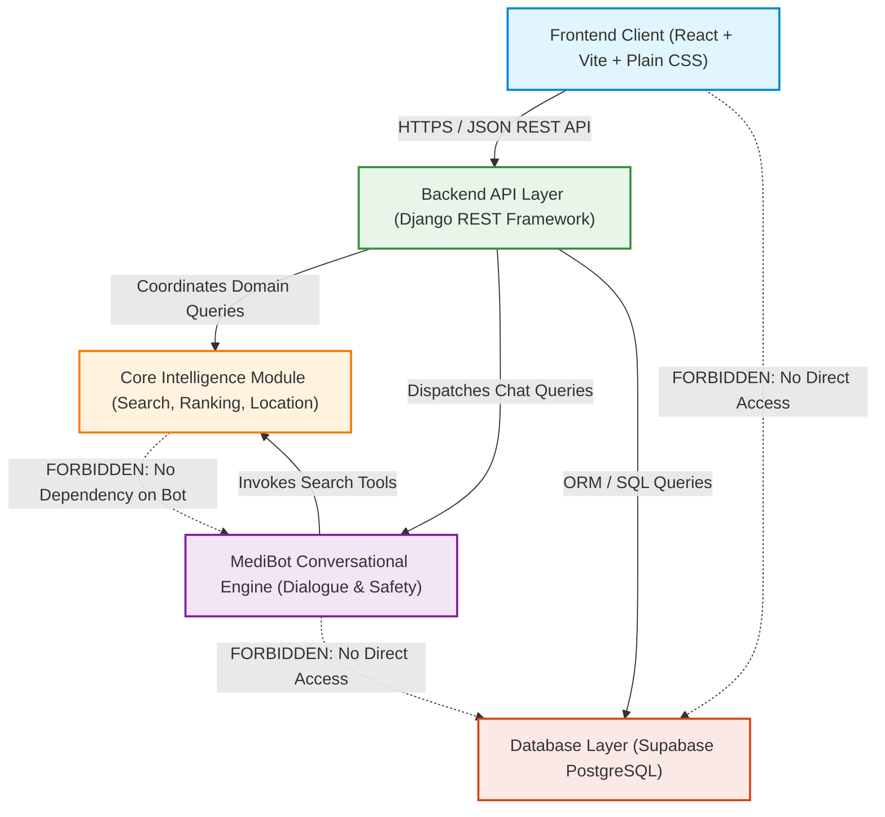
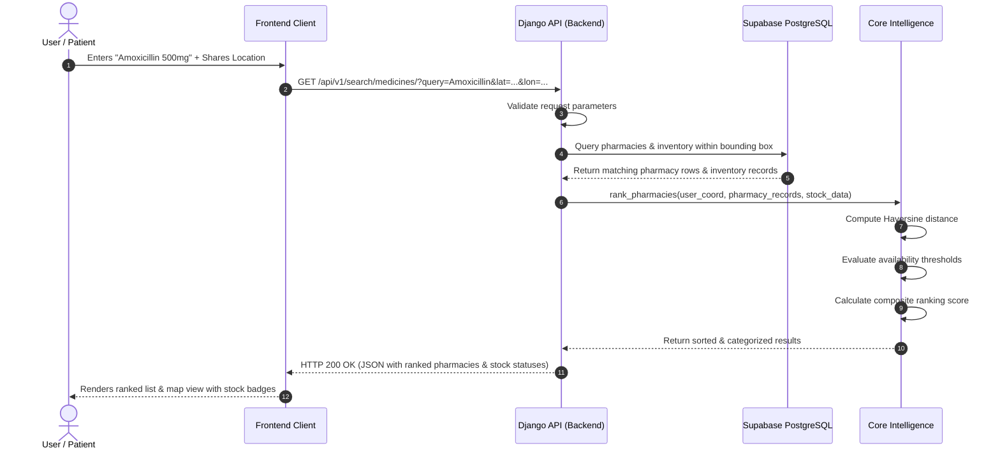
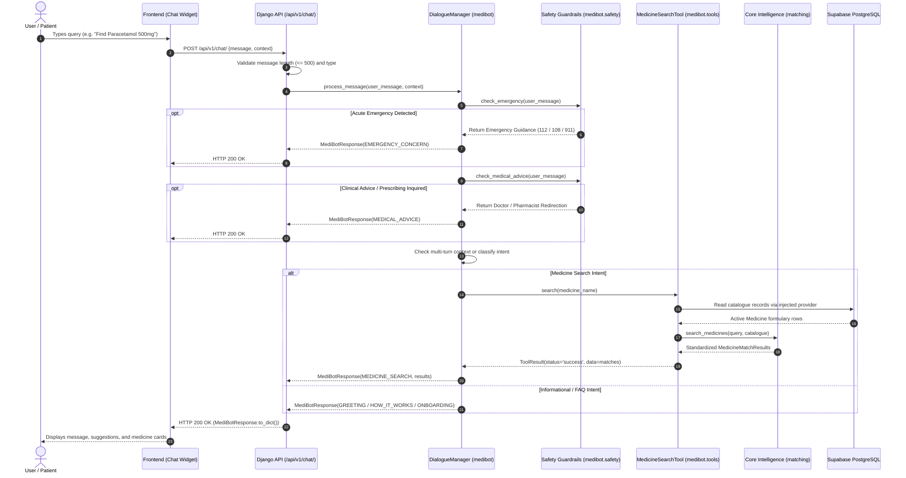

# MediLocate AI — System Architecture

This document defines the architectural boundaries, dependency directions, communication contracts, and component responsibilities across the **MediLocate AI** platform.

---

## 1. System Overview & Dependency Direction

MediLocate AI is designed around a **clean, layered architecture** with strict separation of concerns. Modules interact only through designated interfaces, preventing tight coupling and circular dependencies.

### Dependency Rules:
1. **Unidirectional Flow:** Higher-level layers consume lower-level domain modules. Lower-level modules never hold references to upper layers.
2. **Frontend Independence:** The Frontend communicates exclusively with the Django REST Framework backend API via an abstracted HTTP service layer. Direct calls to database instances or exposing Supabase service credentials in client bundles are strictly forbidden.
3. **Core Intelligence Independence:** `core_intelligence` has **zero** dependencies on the Django web framework, the database, or `medibot`. It is a pure algorithmic library that accepts structured data and returns calculated results.
4. **MediBot Isolation:** `medibot` never queries the database directly. When MediBot needs to look up pharmacies or medicines, it uses tool interfaces provided by `core_intelligence`, fed with data retrieved by the backend orchestrator.

---

## 2. Module Responsibilities

### 2.1 Frontend (`frontend/`)
- **User Interface & Interaction:** Provides responsive search, interactive pharmacy listing, stock badges, distance calculation displays, and an expandable MediBot chat interface.
- **Dedicated Service Layer:** All network calls are encapsulated in `frontend/src/services/` (e.g., `apiClient.js`, `medicineService.js`, `chatService.js`).
- **No Secrets Policy:** Only public environment variables (such as `VITE_API_BASE_URL`) may be bundled. No database connection strings or administrative API keys are ever stored in frontend assets.

### 2.2 Backend (`backend/`)
- **API Endpoints & Routing:** Exposes RESTful endpoints built with Django REST Framework (DRF). Currently serving `/api/v1/health/` liveness check, with modular routers for medicine lookup, pharmacy geolocation, stock inquiries, and chat interactions.
- **Request Validation & Security:** Sanitizes and validates all client payloads before processing. Configured with explicit CORS headers (`django-cors-headers`), secure session cookies, and standardized JSON error formatting.
- **Domain Orchestration:** Coordinates data fetching from PostgreSQL, formats inputs for `core_intelligence`, and dispatches conversation inputs to `medibot`.
- **Modular App Architecture:**
  - `apps.pharmacies`: Manages licensed pharmacy records, WGS84 geo-coordinates, operating hours, and verification status.
  - `apps.medicines`: Standardized pharmaceutical product catalog (generic and brand names, forms, dosages, search aliases) decoupled from pharmacy inventory.
  - `apps.inventory`: Relational junction mapping medicines to pharmacies with stock quantities, unit pricing, timestamps, and dynamic availability classification (`get_availability_status`).
  - `apps.accounts`: Authentication and user profile scaffolding (planned for future phase).
  - `apps.search`: Search orchestration endpoints (planned for Phase 6).
- **Database Connection Strategy:** Uses `psycopg` (Psycopg 3) with SSL (`require`) connecting to Supabase PostgreSQL (IPv4 session-pooler or direct IPv6), with an automatic fallback to local SQLite for offline developer environments.

### 2.3 Core Intelligence (`core_intelligence/`)
A pure Python algorithm engine completely decoupled from web frameworks, network calls, and databases.
- **Search Engine (`search_engine/`):**
  - `normalization.py`: Unicode NFKC normalization, lowercase folding, word-safe microgram unit standardization (`µg`/`ug` $\rightarrow$ `mcg`), punctuation stripping, and strength formatting (e.g., `500mg` $\rightarrow$ `500 mg`, `0.5%` $\rightarrow$ `0.5 %`).
  - `matching.py`: Multi-tier matching (exact generic/brand, exact aliases, partial names, difflib fuzzy matching) with strict **medication identity safeguards** preventing unauthorized dosage or formulation substitutions (e.g. 500mg request excludes 650mg; syrup request excludes tablets).
- **Availability & Freshness Engine (`availability/`):**
  - `rules.py`: Canonical stock level classification (`AVAILABLE`, `LOW_STOCK`, `OUT_OF_STOCK`, `UNKNOWN`) with configurable thresholds and strict validation rejecting negative quantities.
  - `freshness.py`: Timezone-aware record age evaluation against configurable thresholds (default 24h). Enforces presentation safety: stale known stock displays `OUTDATED` / `UNCONFIRMED` rather than false `AVAILABLE` or `OUT_OF_STOCK`.
- **Location Engine (`location/`):**
  - `distance.py`: Validated great-circle Haversine formula ($R = 6371.0\text{ km}$), boundary checks ($[-90, 90]$, $[-180, 180]$), antimeridian crossing handling, and radius filtering with safe null handling (never fabricates distances).
- **Ranking Engine (`ranking/`):**
  - `scoring.py`: Multi-factor composite heuristic scoring:
    $$\text{Composite Score} = 0.45 \cdot S_{\text{rel}} + 0.30 \cdot S_{\text{avail}} + 0.15 \cdot S_{\text{dist}} + 0.10 \cdot S_{\text{price}}$$
    Guarantees relevance dominates over cheap/near irrelevant drugs; ensures missing distance (0.20) and missing price (0.50) are never treated as 0 km or free.
  - `explanations.py`: Generates standardized machine-readable reason codes (`EXACT_MATCH`, `IN_STOCK_CONFIRMED`, `STALE_STOCK_CAUTION`, `PROXIMITY_ADVANTAGE`) and transparent human explanations.
  - Guarantees complete **input immutability** and deterministic multi-key tie-breaking.

### 2.4 MediBot (`medibot/`)
An independent, pure-Python conversational intelligence package designed for safe medicine discovery. Does not import Django models or query PostgreSQL directly; data and tools are injected by backend services.
- **Safety Subsystem (`safety/`):**
  - `input_validation.py`: Sanitizes user inputs, enforces max 500-character length limits, and rejects non-string/empty payloads.
  - `emergency.py`: First-priority safety interceptor detecting acute emergencies (chest pain, breathing difficulty, stroke, overdose, severe hemorrhage) and returning immediate regional emergency hotline guidance (112 / 108 / 911).
  - `safety_rules.py`: Second-priority guardrail intercepting prescription, diagnosis, dosage calculation, or drug alteration inquiries and redirecting users to licensed physicians and pharmacists.
- **Intent Recognition (`intents/`):**
  - `patterns.py`: Deterministic compiled regular expressions for 8 supported intent types: `EMERGENCY_CONCERN`, `MEDICAL_ADVICE`, `GREETING`, `HOW_IT_WORKS`, `PHARMACY_ONBOARDING`, `AVAILABILITY_HELP`, `PHARMACY_SEARCH`, `MEDICINE_SEARCH`, and `UNKNOWN`.
  - `classifier.py`: Rule-based intent classifier with strict safety precedence ordering.
- **Tool Adapter Layer (`tools/`):**
  - `interfaces.py`: Clean Protocols and `ToolResult` contracts for medicine and pharmacy search.
  - `medicine_search.py`: Connects to injectable catalogue provider, delegates discovery to `core_intelligence.search_engine.matching.search_medicines`, and enforces medication identity safeguards.
  - `pharmacy_search.py`: Honest placeholder returning unpopulated/unavailable status until Phase 6 integration without fabricating false stores.
- **Dialogue Management (`dialogue/`):**
  - `context.py`: Defines `ConversationContext` (whitelisted non-sensitive state) and `MediBotResponse` (standardized JSON payload schema).
  - `responses.py`: Deterministic templates and formatting for search results, stock status explanations, and onboarding guidance.
  - `manager.py`: `DialogueManager` coordinating validation, safety filters, multi-turn state (e.g. `awaiting_medicine_name`), and tool execution.

### 2.5 Database (`database/`)
- **Source of Truth:** Hosted on Supabase PostgreSQL.
- **Schema Management:** Version-controlled DDL scripts and Django database migrations.
- **Audit Trails:** Tracks stock updates, batch expirations, and inventory adjustments for compliance.

---

## 3. End-to-End Request Flows

### 3.1 Medicine Search & Location Flow

### 3.2 MediBot Conversational Query Flow

---

## 4. Database Abstraction Decisions

1. **Centralized Backend Gatekeeper:** The frontend client **never** talks directly to Supabase via `@supabase/supabase-js` for domain queries. All data access is routed through Django REST Framework.
   - *Rationale:* Eliminates exposed database credentials, enforces server-side business rules, guarantees audit logging on inventory adjustments, and prevents client tampering with stock levels.
2. **PostgreSQL Relational Integrity:** We use foreign keys with cascading restrictions (`ON DELETE RESTRICT`) on critical medical and inventory records to prevent orphaned stock data.
3. **Fictional Test Data Isolation:** Initial development and demonstration environments utilize strictly fictional pharmacies and medicine inventory records to prevent confusion with real medical establishments.
4. **Dynamic Stock Classification vs Redundant Columns:** Rather than persisting a static, desynchronized `stock_status` text column in the `inventory` table, availability status is dynamically evaluated via the `get_availability_status()` model method based on real-time `quantity` (`NULL` -> `UNKNOWN`, `0` -> `OUT_OF_STOCK`, `<10` -> `LOW_STOCK`, `>=10` -> `AVAILABLE`), ensuring single source of truth.
