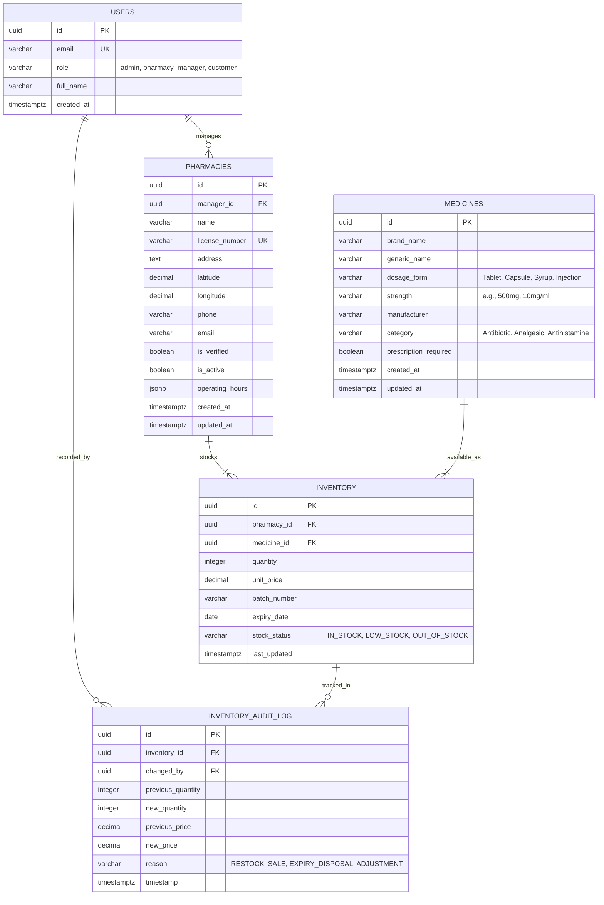

# MediLocate AI — Database Design Specification

> [!NOTE]
> **Status:** Phase 3 Implemented Foundation (Core Tables) & Planned Extensions (Audit & User Roles)
> The core domain entities (`pharmacies`, `medicines`, `inventory`) have been formally defined in Django ORM models and initial database migrations (`0001_initial.py`) in Phase 3. The `users` / role management and `inventory_audit_log` tables remain planned specifications for future phases.

---

## 1. Relational Architecture Overview

The MediLocate AI database uses a **Supabase-hosted PostgreSQL** instance. The schema is organized around five primary entity domains:

1. **Accounts & Users (`users`):** Authentication profiles, roles, and authorization levels.
2. **Pharmacies (`pharmacies`):** Licensed pharmacy establishments, geo-coordinates, contact details, and operating hours.
3. **Medicines (`medicines`):** Standardized drug catalog including generic and brand names, strengths, forms, and regulatory prescription status.
4. **Inventory (`inventory`):** Many-to-many relationship linking pharmacies to medicines, tracking real-time quantities, unit prices, batches, and stock status.
5. **Inventory Audit Logs (`inventory_audit_log`):** Immutable compliance trail logging every change in stock quantity, price, or batch information.

---

## 2. Table Specifications & Constraints

### 2.1 `users`
Represents registered users within the platform.
- `id` (UUID, Primary Key, `default gen_random_uuid()`): Unique identifier.
- `email` (VARCHAR(255), Unique, Not Null): Normalized email address.
- `role` (VARCHAR(50), Not Null): User permission tier (`'customer'`, `'pharmacy_manager'`, `'admin'`).
- `full_name` (VARCHAR(150)): Display name.
- `created_at` (TIMESTAMPTZ, Not Null, `default now()`): Timestamp of account creation.

### 2.2 `pharmacies`
Stores verified pharmacy locations and metadata.
- `id` (UUID, Primary Key, `default gen_random_uuid()`).
- `manager_id` (UUID, Foreign Key -> `users(id)`, Nullable, `ON DELETE SET NULL`).
- `name` (VARCHAR(255), Not Null): Registered pharmacy name.
- `license_number` (VARCHAR(100), Unique, Not Null): Official regulatory operating license.
- `address` (TEXT, Not Null): Physical street address.
- `latitude` (NUMERIC(9, 6), Not Null): WGS 84 latitude coordinate.
- `longitude` (NUMERIC(9, 6), Not Null): WGS 84 longitude coordinate.
- `phone` (VARCHAR(30), Not Null): Contact phone number.
- `email` (VARCHAR(255), Not Null): Public communication email.
- `is_verified` (BOOLEAN, Not Null, `default false`): Admin verification flag.
- `is_active` (BOOLEAN, Not Null, `default true`): Current operational status.
- `operating_hours` (JSONB): Structured schedule per day of the week.
- `created_at` (TIMESTAMPTZ, Not Null, `default now()`).
- `updated_at` (TIMESTAMPTZ, Not Null, `default now()`).

**Integrity Constraints & Indexes:**
- `CHECK (latitude BETWEEN -90.0 AND 90.0)`
- `CHECK (longitude BETWEEN -180.0 AND 180.0)`
- `INDEX idx_pharmacies_geo ON pharmacies (latitude, longitude)`
- `INDEX idx_pharmacies_active ON pharmacies (is_active, is_verified)`

### 2.3 `medicines`
Catalog of pharmaceutical products, active ingredients, and regulatory categorizations.
- `id` (UUID, Primary Key, `default gen_random_uuid()`).
- `brand_name` (VARCHAR(255), Not Null): Commercial trade name (e.g., "Tylenol").
- `generic_name` (VARCHAR(255), Not Null): Active chemical constituent (e.g., "Paracetamol / Acetaminophen").
- `dosage_form` (VARCHAR(100), Not Null): Formulation (e.g., "Tablet", "Capsule", "Suspension").
- `strength` (VARCHAR(100), Not Null): Unit dosage (e.g., "500 mg", "250 mg / 5 mL").
- `manufacturer` (VARCHAR(255), Not Null): Pharmaceutical manufacturer.
- `category` (VARCHAR(100), Not Null): Therapeutic classification (e.g., "Analgesic", "Antibiotic").
- `prescription_required` (BOOLEAN, Not Null, `default false`): Rx requirement flag.
- `created_at` (TIMESTAMPTZ, Not Null, `default now()`).
- `updated_at` (TIMESTAMPTZ, Not Null, `default now()`).

**Integrity Constraints & Indexes:**
- `INDEX idx_medicines_generic ON medicines USING gin (to_tsvector('english', generic_name))`
- `INDEX idx_medicines_brand ON medicines USING gin (to_tsvector('english', brand_name))`
- `UNIQUE (brand_name, generic_name, dosage_form, strength)`

### 2.4 `inventory`
Real-time stock levels of medicines stocked at specific pharmacies.
- `id` (UUID, Primary Key, `default gen_random_uuid()`).
- `pharmacy_id` (UUID, Foreign Key -> `pharmacies(id)`, Not Null, `ON DELETE CASCADE`).
- `medicine_id` (UUID, Foreign Key -> `medicines(id)`, Not Null, `ON DELETE RESTRICT`).
- `quantity` (INTEGER, Nullable, `default None`): Available unit count. Nullable to cleanly distinguish between unknown/unconfirmed stock (`None`) and confirmed zero stock (`0`).
- `unit_price` (NUMERIC(10, 2), Not Null, `default 0.00`): Current price per standard unit.
- `last_updated` (TIMESTAMPTZ, Not Null, `default now()`).
- `is_demo` (BOOLEAN, Not Null, `default True`): Demo data flag.

**Dynamic Status vs Static Column:**
Rather than maintaining a desynchronized text column (`stock_status`), status is computed in real time via `inventory.get_availability_status()`:
- `quantity is None` -> `'UNKNOWN'`
- `quantity == 0` -> `'OUT_OF_STOCK'`
- `quantity < 10` -> `'LOW_STOCK'`
- `quantity >= 10` -> `'AVAILABLE'`

**Integrity Constraints & Indexes:**
- `CHECK (quantity >= 0 OR quantity IS NULL)`
- `CHECK (unit_price >= 0.00)`
- `UNIQUE (pharmacy_id, medicine_id)`
- `INDEX idx_inventory_lookup ON inventory (medicine_id, pharmacy_id)`

### 2.5 `inventory_audit_log`
Immutable regulatory log tracking every stock modification.
- `id` (UUID, Primary Key, `default gen_random_uuid()`).
- `inventory_id` (UUID, Foreign Key -> `inventory(id)`, Not Null, `ON DELETE CASCADE`).
- `changed_by` (UUID, Foreign Key -> `users(id)`, Nullable, `ON DELETE SET NULL`).
- `previous_quantity` (INTEGER, Not Null).
- `new_quantity` (INTEGER, Not Null).
- `previous_price` (NUMERIC(10, 2)).
- `new_price` (NUMERIC(10, 2)).
- `reason` (VARCHAR(100), Not Null): Reason for modification (`'RESTOCK'`, `'DISPENSED'`, `'EXPIRED'`, `'INVENTORY_RECONCILIATION'`).
- `timestamp` (TIMESTAMPTZ, Not Null, `default now()`).

---

## 3. Seed Data Strategy

When the database is provisioned in Phase 3:
- **Strictly Fictional Data:** All initial seed records (pharmacy names, addresses, phone numbers, batches) will be explicitly fictional (e.g., *"Apex Care Pharmacy - Branch 1"*, *"Fictional Health Street 101"*, fictitious coordinates).
- **No Real Medical Data:** Prevents conflation of mock data with live operational medical inventories.
- **Repeatable Seeds:** SQL seed scripts will be maintained in `database/seeds/01_fictional_seed.sql` for automated test and development resets.
