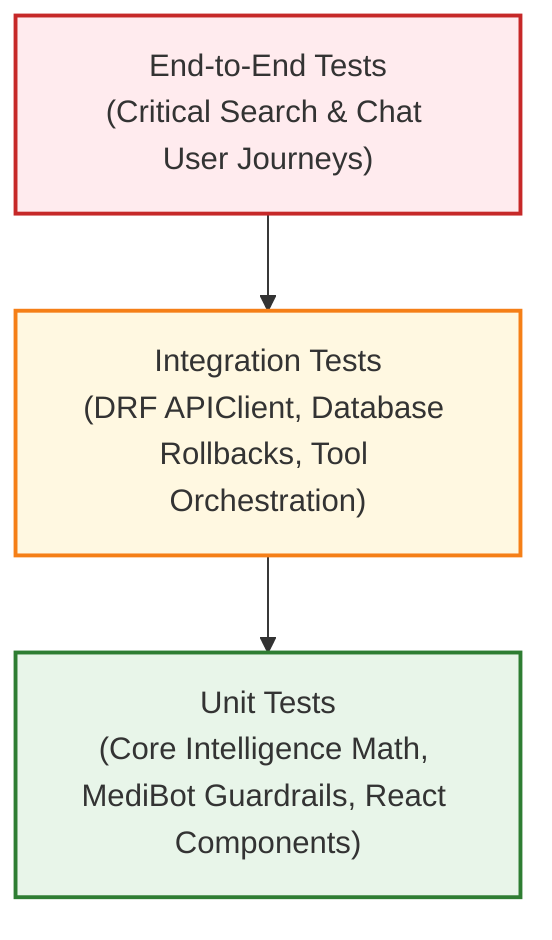

# MediLocate AI — Testing Strategy

> [!NOTE]
> **Status:** Strategic Blueprint
> This document details the testing architecture, standards, and verification procedures for MediLocate AI. Planned test suites will be implemented alongside application code in **Phases 2 through 7**.

---

## 1. Testing Philosophy & Test Pyramid

MediLocate AI employs a rigorous multi-tier testing strategy ensuring data accuracy, medical safety guardrails, and deterministic search and ranking logic.

---

## 2. Multi-Tiered Test Scope

### 2.1 Core Intelligence Unit Tests (`core_intelligence/tests/`)
- **Framework:** `pytest` (invoked via `.\venv\Scripts\python.exe -m pytest core_intelligence/tests -q`)
- **Scope & Isolation:** Completely decoupled from web frameworks, network requests, and databases.
- **Implemented Test Coverage (67 Tests Passing):**
  - **Normalization (`test_normalization.py` - 18 tests):**
    - Case folding, whitespace collapsing, Unicode NFKC accents, full-width conversions, and microgram unit standardization.
    - Medically significant punctuation retention (decimals, slashes, percentages, hyphens).
    - Strength format spacing (`500 mg`, `0.5 %`, `250 mg / 5 ml`, `10 mcg`).
    - Tokenization and empty/None/invalid input handling.
    - Explicit dosage and form extraction (`extract_strength_and_form`).
  - **Medicine Matching (`test_medicine_matching.py` - 10 tests):**
    - Exact generic name matches and exact brand name matches (`match_score = 1.0`).
    - Exact alias matching across synonyms (e.g. *acetaminophen* $\rightarrow$ *Paracetamol*).
    - Partial name matching with substring and boundary checks.
    - Supporting difflib fuzzy matching with configurable thresholds.
    - **Medication identity safeguards:** Strict exclusion of conflicting strengths (500mg request excludes 650mg) and conflicting dosage forms (syrup request excludes tablets).
    - Missing optional catalogue fields handling.
    - Deterministic ordering (score DESC, brand ASC, id ASC) and limit slicing.
  - **Availability Rules (`test_availability.py` - 10 tests):**
    - Unknown quantity (`None` $\rightarrow$ `UNKNOWN`; never converted to zero).
    - Confirmed zero quantity (`0` $\rightarrow$ `OUT_OF_STOCK`).
    - Boundary transitions (`< 10` $\rightarrow$ `LOW_STOCK`; $\ge 10$ $\rightarrow$ `AVAILABLE`).
    - Validation rejecting negative numbers (`-1`), non-integer floats, and booleans.
    - Custom threshold configurations.
  - **Freshness & Presentation (`test_freshness.py` - 11 tests):**
    - Record age evaluation (fresh, exact threshold, stale, missing timestamp).
    - Future timestamp rejection and naive/aware timezone handling.
    - Combined user presentation: stale stock displays `OUTDATED` / `UNCONFIRMED`.
    - Missing quantity always displays `UNKNOWN` regardless of timestamp age.
  - **Geospatial Distance (`test_distance.py` - 9 tests):**
    - Same coordinate identity ($0.0\text{ km}$).
    - Equatorial degree validation (~$111.195\text{ km}$) and known city pair (London-Paris ~$343.5\text{ km}$).
    - Symmetry ($A \rightarrow B = B \rightarrow A$).
    - Antimeridian crossing (179° to -179° = ~$222.4\text{ km}$, not 39,000 km).
    - Out-of-bounds latitude/longitude and non-finite value rejections.
    - Safe distance wrapper (returns `None`, never fabricates distances) and radius filtering.
  - **Transparent Ranking (`test_ranking.py` - 9 tests):**
    - High relevance dominates over cheap/near irrelevant drugs.
    - Fresh verified stock outranks stale unconfirmed stock.
    - Distance proximity ordering and price tie-breaking.
    - Missing distance (0.20 penalty) and missing price (0.50 neutral) handling.
    - Input candidate immutability verification.

### 2.2 MediBot Unit & Safety Tests (`medibot/tests/`)
- **Framework:** `pytest` (invoked via `.\venv\Scripts\python.exe -m pytest medibot/tests -v`)
- **Implemented Test Coverage (48 Tests Passing):**
  - **Input Sanitization & Bounds (`test_safety.py` - 5 tests):**
    - Stripping surrounding whitespace.
    - Rejection of empty strings and whitespace-only strings with `needs_clarification` status.
    - Rejection of non-string types (`None`, `int`, `bool`, `list`, `dict`) with `error` status.
    - Strict message length bounding (max 500 characters enforced; $>500$ rejected).
    - Boundary length acceptance (500 characters allowed).
  - **Medical Advice Guardrail (`test_safety.py` - 7 tests):**
    - Treatment recommendation interception (*"What should I take for severe headache?"*).
    - Prescribing request interception (*"Can you recommend a medicine for fever?"*).
    - Dosage recommendation interception (*"How much Paracetamol should I give my 5 year old?"*).
    - Medication alteration/stopping interception (*"Should I stop taking my blood pressure medicine?"*).
    - Diagnostic inquiry interception (*"Diagnose my skin rash"*).
    - Drug interaction interception (*"Can I take Ibuprofen with Aspirin?"*).
    - General product questions pass without false positives (*"What does low stock mean?"*, *"How does MediLocate work?"*).
  - **Emergency Protocol Interception (`test_safety.py` - 5 tests):**
    - Chest pain emergency interception.
    - Acute breathing emergency interception.
    - Overdose / poisoning emergency interception.
    - Stroke symptom interception.
    - Immediate emergency hotline numbers provided (112 / 108 / 911).
  - **Safety Precedence in Dialogue Manager (`test_safety.py` - 2 tests):**
    - Emergency concerns pre-empt ordinary medicine searches.
    - Medical advice requests pre-empt ordinary medicine searches.
  - **Intent Classification (`test_intents.py` - 10 tests):**
    - `GREETING` intent with confidence scoring.
    - `HOW_IT_WORKS` intent.
    - `PHARMACY_ONBOARDING` intent across phrasing variations.
    - `AVAILABILITY_HELP` intent for inventory badges.
    - `PHARMACY_SEARCH` intent.
    - `MEDICINE_SEARCH` generic intent without entity extraction.
    - `MEDICINE_SEARCH` specific intent with entity extraction.
    - Safety precedence verification in classifier (`EMERGENCY_CONCERN` and `MEDICAL_ADVICE`).
    - `UNKNOWN` intent fallback.
  - **Tool Adapters (`test_tools.py` - 10 tests):**
    - Exact medicine search execution via Core Intelligence.
    - Strength safeguard enforcement in tools (500mg request excludes 650mg).
    - Empty query handling and empty catalogue graceful unavailable handling.
    - Disconnected provider handling (no database crash).
    - Exception isolation in catalogue providers.
    - Pharmacy search default tool returning honest unavailable status in Phase 5.
    - Custom pharmacy provider support.
  - **Dialogue Workflows & Contract (`test_dialogue.py` - 9 tests):**
    - Greeting, How It Works, Pharmacy Onboarding, and Availability workflows.
    - Direct medicine search workflow returning formatted results.
    - Multi-turn clarification workflow (`awaiting_medicine_name` context transition).
    - Unsupported question handling.
    - Full serialization test verifying `MediBotResponse.to_dict()` keys: `message`, `intent`, `status`, `suggestions`, `results`, `demo_notice`, `safety_category`, `context`.

### 2.3 Backend API & Model Tests (`backend/tests/`)
- **Framework:** Django Test Runner (`backend/manage.py test tests apps`) with `rest_framework.test.APIClient`
- **Execution:** Runs in an isolated SQLite in-memory/temp database, executing all migrations and ensuring zero pollution of production databases.
- **Implemented Test Coverage (29 Tests Passing):**
  - **Health Endpoint (`backend/tests/test_health.py` - 2 tests):**
    - `test_health_endpoint_success`: Asserts HTTP 200 and JSON structure `{status: 'ok', service: 'MediLocate API'}`.
    - `test_health_endpoint_no_sensitive_data_exposed`: Asserts no credentials or secrets leaked.
  - **Pharmacy Model (`backend/tests/test_models.py` - 4 tests):**
    - Creation, string representation, WGS84 latitude/longitude bounds (`[-90, 90]`, `[-180, 180]`), verification status choices.
  - **Medicine Model (`backend/tests/test_models.py` - 3 tests):**
    - Creation, string representation, JSON search aliases storage.
  - **Inventory Model (`backend/tests/test_models.py` - 7 tests):**
    - Creation, unique constraint `(pharmacy, medicine)`, non-negative price/quantity, delete cascade/protect, and dynamic availability calculation.
  - **MediBot Chat API Endpoint (`backend/tests/test_chat_api.py` - 13 tests):**
    - `test_greeting_message`: Valid greeting returns HTTP 200 with `GREETING` intent.
    - `test_emergency_interception`: Acute emergency returns HTTP 200 with `EMERGENCY_CONCERN`, `safety_category: "emergency_concern"`, and emergency hotline guidance.
    - `test_medical_advice_interception`: Clinical advice query returns HTTP 200 with `MEDICAL_ADVICE` and doctor redirection.
    - `test_medicine_search_direct`: Specific query searches database and returns matching medicine results.
    - `test_generic_medicine_search_needs_clarification`: Generic query returns `needs_clarification` and context `awaiting_medicine_name`.
    - `test_multi_turn_continuation_with_context`: Follow-up with context resolves search against seeded medicine.
    - `test_empty_message_returns_400`: Empty string returns HTTP 400 Bad Request.
    - `test_whitespace_message_returns_400`: Whitespace-only string returns HTTP 400 Bad Request.
    - `test_missing_message_field_returns_400`: Missing `message` returns HTTP 400 Bad Request.
    - `test_non_string_message_returns_400`: Integer/non-string `message` returns HTTP 400 Bad Request.
    - `test_oversized_message_returns_400`: Message $>500$ chars returns HTTP 400 Bad Request.
    - `test_invalid_context_type_returns_400`: Non-object `context` returns HTTP 400 Bad Request.
    - `test_unsupported_methods_return_405`: GET, PUT, DELETE methods return HTTP 405 Method Not Allowed.
  - **Inventory Model (`backend/tests/test_models.py`):**
    - `test_inventory_creation`: Verifies FK relationships to Pharmacy and Medicine.
    - `test_inventory_unique_pharmacy_medicine`: Enforces `UniqueConstraint(pharmacy, medicine)` at database level.
    - `test_inventory_quantity_nullable_and_non_negative`: Verifies nullable quantity and prevents negative stock values.
    - `test_inventory_price_non_negative`: Enforces unit price >= 0.00.
    - `test_inventory_cascade_on_pharmacy_delete`: Asserts deleting a pharmacy cascades to its inventory records.
    - `test_inventory_protect_on_medicine_delete`: Asserts deleting a medicine is RESTRICTED if stocked in inventory.
    - `test_inventory_availability_status_calculation`: Verifies dynamic computation for `UNKNOWN` (None), `OUT_OF_STOCK` (0), `LOW_STOCK` (1..9), and `AVAILABLE` (>= 10).

### 2.4 Frontend Component & UI Tests (`frontend/src/tests/`)
- **Framework:** `vitest` + `@testing-library/react` + `@testing-library/jest-dom`
- **Coverage Criteria:**
  - Component rendering in various states (loading spinner, error message, empty results, populated pharmacy cards).
  - User interaction simulation (typing in search bar, debounce firing, clicking filter tags, submitting chat messages).
  - API Service Layer mocking: Intercepting HTTP calls to assert correct payload generation and response processing.

---

## 3. Test Data Isolation & Mocking Strategy

1. **No External API Dependencies:** Tests must run hermetically in offline CI environments without requiring external third-party AI APIs or live remote database connections.
2. **Deterministic Seed Fixtures:** Tests utilize static, version-controlled JSON fixtures containing strictly fictional pharmacy and medicine data.
3. **Database Test Isolation:** Django automated test runners automatically spin up a dedicated, isolated test database, execute migrations, run tests in atomic transactions, and destroy the test database upon completion.

---

## 4. Verification & Quality Gates

To maintain code quality across each subsequent phase:

| Phase Gate | Verification Requirement |
| :--- | :--- |
| **Pull Request / Commit** | Unit tests must pass with 100% success rate. |
| **Linting & Standards** | Zero syntax errors, proper formatting, and no undeclared dependencies. |
| **Safety Regression** | All MediBot safety interceptor tests must pass unconditionally before merging. |
| **Clean Secrets Audit** | Git history and commit staged files checked for absence of `.env` files or API secrets. |
